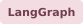
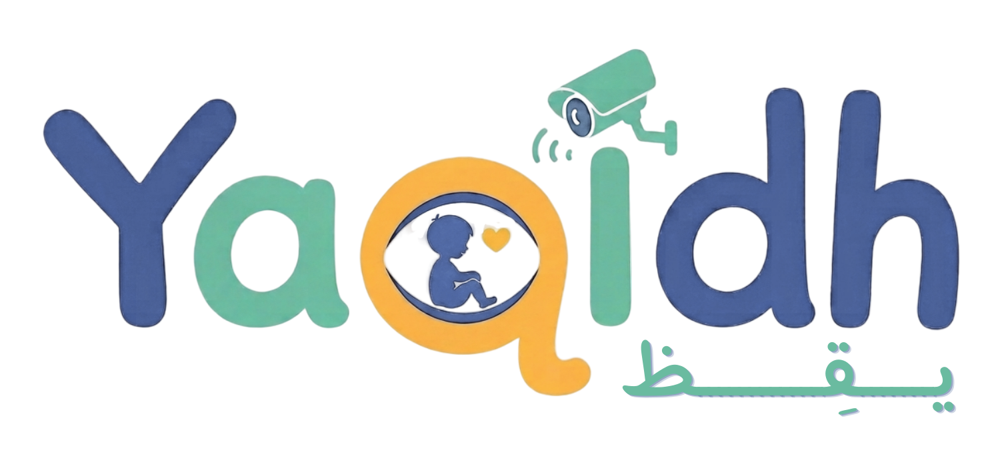
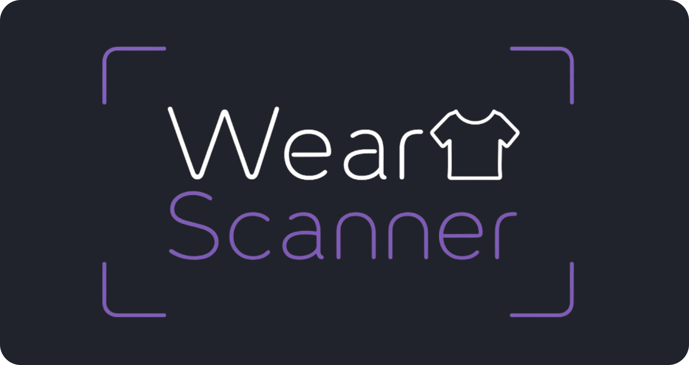
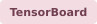

# Hi there, I'm Aliyah! 🌸

 

### About Me

An Artificial Intelligence Specialist who builds end-to-end AI systems across **Computer Vision, NLP, and Generative AI**, and takes them all the way from model development to production deployment. My core strength is training and optimizing detection and classification models, then wrapping them in clean, well-engineered software, with real attention to the things that make AI usable: **latency, model size, privacy, and reliable deployment.**

- **Computer Vision:** object detection, image classification, real-time video analysis
- **Deep Learning:** CNNs & Transformers, including architectures built from scratch
- **NLP & Generative AI:** text classification, LLMs, and RAG
- **Production Engineering:** FastAPI + PostgreSQL backends, React frontends, ONNX-optimized inference

## Tech Stack

### Languages

  
  

### AI / Machine Learning

  
  
  
  
  
  
  
  
  
  

### Backend & Frontend

  
  

### Cloud & Hosting

  
  
  
  

### Tools & Platforms

  
  
  
  
  
  

## Domains & Concepts

  
  
  
  
  
  
  
  
  
  
  

## Projects

<table align="center" width="100%">
<tr><td width="100%" valign="top">

<a href="https://github.com/AliyahAlabdali/InterMind">
<picture>
  <source media="(prefers-color-scheme: dark)" srcset="./assets/projects/intermind-dark.png">
  
</picture>
</a>

<h3>InterMind: Autonomous AI Technical Interviewer</h3>

An agentic AI system that conducts adaptive, role-specific technical interviews. It transforms job descriptions into structured interview plans, asks technical questions, evaluates candidate responses, and dynamically generates follow-up questions based on demonstrated knowledge and gaps.

<strong>Beyond scripted interviews:</strong> LangGraph orchestrates a stateful AI interviewer that supports voice and text interactions, maintains interview context, and produces evidence-based assessment reports with traceable evaluations for recruiters.

  
  
  
  
  

<a href="https://intermind-ai.vercel.app"><strong>Live demo</strong></a> &nbsp; · &nbsp; <a href="https://github.com/AliyahAlabdali/InterMind">Repository</a>

</td></tr>
</table>

<table align="center" width="100%">
<tr><td width="100%" valign="top">

<h3>Yaqidh: Live Child Safety</h3>

Detects falls and physical aggression in live CCTV using two YOLOv8s models with ONNX-optimized inference. Role-based dashboards connect live WebSocket, SMS, and email alerts with incident records and archived video clips for caregiver review.

<strong>Detection to response:</strong> zone-scoped alerts and video-backed incident records support caregiver review.

  
  
  

<a href="https://drive.google.com/file/d/1gR5Adeat6XKeJb-j9T-kjN15vZKI8x94/view"><strong>Video demo</strong></a> &nbsp; · &nbsp; <a href="https://github.com/Yaqidh-Project/Yaqidh">Repository</a>

</td></tr>
</table>

<table align="center" width="100%">
<tr><td width="100%" valign="top">

<a href="https://github.com/AliyahAlabdali/Nabeeh">
<picture>
  <source media="(prefers-color-scheme: dark)" srcset="./assets/projects/nabeeh-dark.svg">
  
</picture>
</a>

<h3>Nabeeh | نَبيه: SMS Scam Detection</h3>

A from-scratch PyTorch Transformer for English SMS scam/spam detection, with custom multi-head attention, pre-LayerNorm, and masked pooling. The notebook combines class-weighted training, validation macro-F1 checkpointing, attention-head ablation, and error analysis.

<strong>98.07% test accuracy · 0.9542 macro-F1</strong> across 517 held-out SMS messages.

  
  
  

<a href="https://huggingface.co/spaces/AliyahAlabdali/sms-scam-detector"><strong>Hugging Face demo</strong></a> &nbsp; · &nbsp; <a href="https://github.com/AliyahAlabdali/Nabeeh">Repository</a>

</td></tr>
</table>

<table align="center" width="100%">
<tr><td width="100%" valign="top">

<h3>WearScanner: Fashion Classifier</h3>

A three-block TensorFlow CNN uses batch normalization and dropout to classify 10 Fashion-MNIST clothing categories. TensorBoard records training, and a Colab upload demo pairs predictions with occasion, accessory, and color suggestions.

<strong>92.92% test accuracy · 93.13% precision</strong> on the 21,000-image evaluation split.

  
  
  

 &nbsp; · &nbsp; <a href="https://github.com/RenadAlh/WearScanner">Repository</a>

</td></tr>
</table>

Looking for more? Browse my full set of repositories and latest work on [my GitHub profile](https://github.com/AliyahAlabdali?tab=repositories).

## Contact

Let's connect. I'm open to AI / ML roles and collaborations.

&nbsp;&nbsp;&nbsp;

&nbsp;&nbsp;&nbsp;

🌸 Thanks for visiting! Let's build something great together. 🌸

